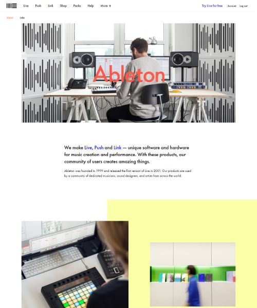

# Ableton - About Page Project 🎵

A frontend implementation project cloning the iconic, editorial **Ableton About Page** from [Frontend Practice](https://www.frontendpractice.com/projects/ableton).

This project challenges frontend developers on typography hierarchy, whitespace and layout rhythm, complex asymmetrical CSS grids, and responsive multi-column footers.

---

## 📚 Project Documentation & Guides

- 📖 **[style-guide.md](./style-guide.md)** — Complete design system containing exact color tokens, typography scales, layout dimensions, and image asset mapping.
- 🤖 **[AGENTS.md](./AGENTS.md)** — AI Mentor & Pair-Programming Guide designed for Antigravity (strictly enforces mentor mode, step-by-step guidance, and debugging assistance without generating code).
- 🖼️ **[images/](./images/)** — All high-resolution photo assets, vector SVGs, and the complete reference mockup (`fullsize-reference.jpg`).

---

## 🎯 Key Learning Focus Areas

1. **Unique Asymmetrical Grids:** Crafting offset, overlapping image grids with distinctive pastel backdrop blocks (`#fbffa7`, `#b6ffc0`, `#d5b3ff`).
2. **Editorial Typography:** Geometric sans-serif hierarchy, generous line-heights, and bold hero typography overlays.
3. **Sticky Sub-navigation:** Implementing a smooth, sticky sub-header bar (`position: sticky; top: 0;`).
4. **Multi-Column Responsive Footer:** Clean 4-column desktop footer collapsing seamlessly to mobile viewports.
5. **Bonus Challenge:** Interactive mega-menu on clicking "More +".

---

## 🚀 Live & Visual References

- **Full Reference Screenshot:** [`./images/fullsize-reference.jpg`](./images/fullsize-reference.jpg)
- **Official Ableton Live Page:** [https://www.ableton.com/en/about/](https://www.ableton.com/en/about/)
- **Frontend Practice Challenge:** [https://www.frontendpractice.com/projects/ableton](https://www.frontendpractice.com/projects/ableton)

---

## 👤 Author

- **GitHub:** [@AGreatDev-coder](https://github.com/AGreatDev-coder)
