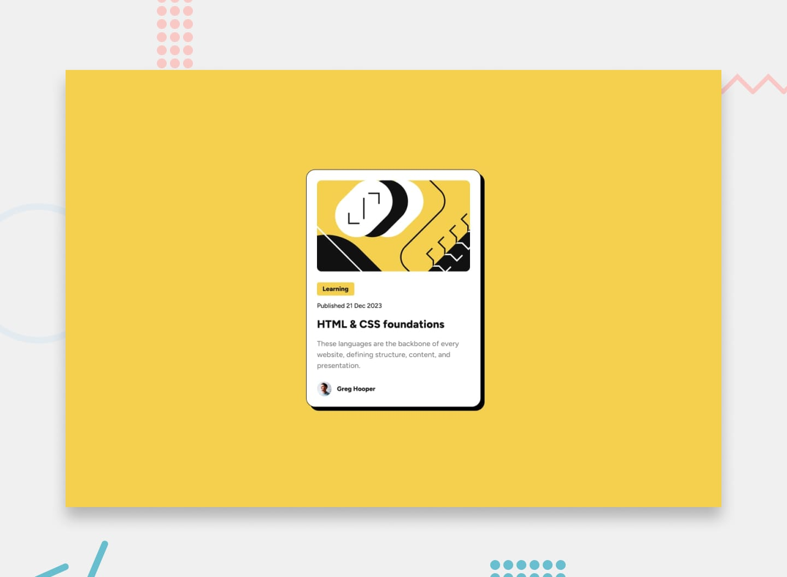

# Blog Preview Card 📰

A modern, responsive blog preview card component crafted with semantic HTML5 and CSS3. The component features a vibrant neo-brutalist design aesthetic with bold outlines, solid offset drop shadows, and interactive hover states.



## 🚀 Live Demo

- **Live URL:** [https://agreatdev-blog-preview-card.netlify.app](https://agreatdev-blog-preview-card.netlify.app)

---

## ✨ Features

- **Semantic HTML5 Markup:** Clean, accessible structure using semantic elements (`<main>`, `<h1>`, `<p>`, `<span>`, ``).
- **Neo-brutalist Styling:** Distinctive hard-edged offset `box-shadow` (`8px 8px 0px 0px black`), crisp borders, and a vibrant color palette.
- **CSS Flexbox Layout:** Perfectly centered on the viewport using Flexbox (`min-height: 100vh; align-items: center; justify-content: center;`).
- **Interactive UI:** Smooth hover state on title with pointer cursor and color transition.
- **Custom Typography:** Integrated with the **Figtree** font family for crisp, modern legibility.

---

## 🛠️ Built With

- **HTML5:** Semantic document structure
- **CSS3:** Custom properties (`:root`), Flexbox, box shadows, transitions
- **Google Fonts:** [Figtree](https://fonts.google.com/specimen/Figtree)

---

## 📁 Project Structure

```text
blog-preview-card-main/
└── blog-preview-card-main/
    ├── assets/
    │   ├── fonts/       # Figtree font files
    │   └── images/      # Card illustration and avatar
    ├── index.html       # Webpage structure
    ├── style.css        # Styling and layout
    ├── preview.jpg      # Project preview banner
    └── README.md        # Project documentation
```

---

## 💻 Getting Started Locally

1. **Clone the repository:**
   ```bash
   git clone https://github.com/AGreatDev-coder/frontend-mentor.git
   ```

2. **Navigate to the project folder:**
   ```bash
   cd frontend-mentor/blog-preview-card-main/blog-preview-card-main
   ```

3. **Open the project:**
   Simply open `index.html` in any browser or launch it using VS Code Live Server.

---

## 👤 Author

- **GitHub:** [@AGreatDev-coder](https://github.com/AGreatDev-coder)
