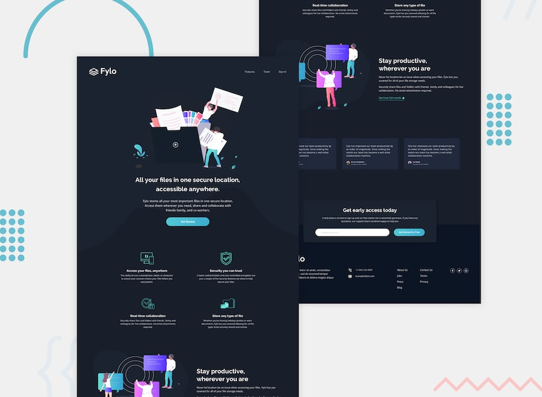

# Fylo - Dark Theme Landing Page 📁

A modern, fully responsive dark-themed product landing page for Fylo, a secure cloud storage and collaboration platform. Built from scratch using semantic HTML5, modern CSS3 with CSS Grid and Flexbox, and mobile-responsive layouts.



## 🚀 Live Demo

- **Live URL:** [https://agreatdev-fylo-dark-theme.netlify.app](https://agreatdev-fylo-dark-theme.netlify.app)
- **Repository:** [https://github.com/AGreatDev-coder/frontend-mentor/tree/main/fylo-dark-theme-landing-page-master/fylo-dark-theme-landing-page-master](https://github.com/AGreatDev-coder/frontend-mentor/tree/main/fylo-dark-theme-landing-page-master/fylo-dark-theme-landing-page-master)

---

## 📋 Table of Contents

- [Overview](#overview)
- [Key Features](#key-features)
- [Architecture & Design Decisions](#architecture--design-decisions)
- [Built With](#built-with)
- [Project Structure](#project-structure)
- [Getting Started Locally](#getting-started-locally)
- [Author](#author)

---

## 🔍 Overview

This project implements a complete, professional SaaS dark-mode marketing landing page. It showcases key product value propositions, four-pillar feature cards, productivity highlights, customer testimonial cards with user profiles, an overlapping call-to-action subscription form, and an exhaustive footer with navigation links and social icons.

### User Experience

- **Fully Responsive Layout:** Fluid design adapting seamlessly between desktop (1440px) and mobile (375px) devices.
- **Interactive States:** Hover effects on navigation links, call-to-action buttons, email inputs, and social icons.
- **Accessible Structure:** Semantic landmarks (`<header>`, `<nav>`, `<main>`, `<section>`, `<footer>`), labeled form fields, and descriptive image alt attributes.

---

## ✨ Key Features

- **Dark Theme Palette:** High-contrast color hierarchy utilizing CSS variables for backgrounds, cards, typography, and call-to-action buttons.
- **2x2 Feature Grid:** Structured CSS Grid displaying key benefits with clean SVG icons and clear typography.
- **Customer Testimonials:** Multi-card testimonial grid featuring user feedback, avatar photos, and company titles.
- **Floating Overlap CTA Card:** A conversion-focused subscription section that gracefully overlaps the transition from the main body into the footer.
- **Curved Background Integration:** Layered curved desktop and mobile vector graphics for fluid section transitions.

---

## 📐 Architecture & Design Decisions

### 1. Floating Call-to-Action Overlap
To achieve the floating effect where the CTA card sits centered across the boundary between the main content and the footer, relative positioning was combined with a negative bottom margin, paired with compensatory top padding on the footer:

```css
.cta {
  position: relative;
  margin-bottom: -120px;
  z-index: 10;
  box-shadow: 0 5px 20px rgba(0, 0, 0, 0.4);
}

footer {
  background-color: var(--bg-footer);
  padding: 180px 20px 80px 20px;
}
```

### 2. Asymmetric Grid Proportions
The footer columns have varying amounts of text (e.g. detailed location address vs. brief navigation links). Using proportional `fr` tracks allows natural text wrapping without squishing:

```css
.footer-grid {
  display: grid;
  grid-template-columns: 2.5fr 1.8fr 1fr 1fr 1fr;
  gap: 40px;
}
```

### 3. Flexbox Form Spacing
Using `flex: 1` on the email input ensures it smoothly absorbs all remaining width inside the subscription container while the button stays snug:

```css
.cta form {
  display: flex;
  align-items: center;
  gap: 20px;
  width: 100%;
}

.cta form input {
  flex: 1;
}
```

---

## 🛠️ Built With

- **HTML5:** Semantic markup (`<header>`, `<nav>`, `<section>`, `<footer>`, `<form>`)
- **CSS3:** Custom properties (`:root`), Flexbox, CSS Grid, media queries
- **Font Awesome 6:** Vector icons for social media links
- **Google Fonts:** [Raleway](https://fonts.google.com/specimen/Raleway) & [Open Sans](https://fonts.google.com/specimen/Open+Sans)

---

## 📁 Project Structure

```text
fylo-dark-theme-landing-page-master/
└── fylo-dark-theme-landing-page-master/
    ├── images/          # Background curves, SVGs, avatars, product illustrations
    ├── index.html       # Landing page markup
    ├── style.css        # Dark theme styling, grids, and responsiveness
    ├── preview.jpg      # Project preview banner
    └── README.md        # Documentation
```

---

## 💻 Getting Started Locally

1. **Clone the repository:**
   ```bash
   git clone https://github.com/AGreatDev-coder/frontend-mentor.git
   ```

2. **Navigate to the project folder:**
   ```bash
   cd frontend-mentor/fylo-dark-theme-landing-page-master/fylo-dark-theme-landing-page-master
   ```

3. **Open the project:**
   Open `index.html` directly in your browser or with VS Code Live Server.

---

## 👤 Author

- **GitHub:** [@AGreatDev-coder](https://github.com/AGreatDev-coder)
