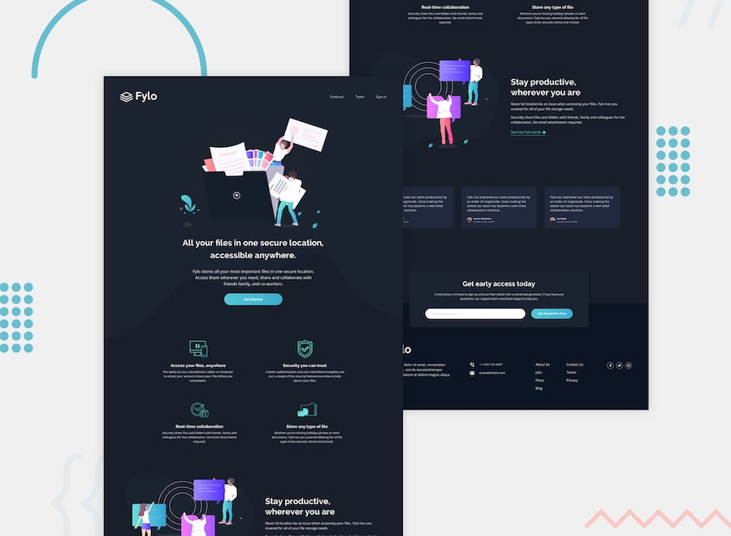

# Frontend Mentor - Fylo dark theme landing page solution

This is a solution to the [Fylo dark theme landing page challenge on Frontend Mentor](https://www.frontendmentor.io/challenges/fylo-dark-theme-landing-page-5ca5f2d21e82137ec91a50fd). Frontend Mentor challenges help you improve your coding skills by building realistic projects.

## Table of contents

- [Overview](#overview)
  - [The challenge](#the-challenge)
  - [Screenshot](#screenshot)
  - [Links](#links)
- [My process](#my-process)
  - [Built with](#built-with)
  - [What I learned](#what-i-learned)
  - [Continued development](#continued-development)
  - [Useful resources](#useful-resources)
- [Author](#author)
- [Acknowledgments](#acknowledgments)

## Overview

### The challenge

Users should be able to:

- View the optimal layout for the site depending on their device's screen size (Desktop & Mobile)
- See hover states for all interactive elements on the page (buttons, navigation links, and social icons)

### Screenshot



### Links

- Solution URL: [https://github.com/AGreatDev-coder/frontend-mentor/tree/main/fylo-dark-theme-landing-page-master/fylo-dark-theme-landing-page-master](https://github.com/AGreatDev-coder/frontend-mentor/tree/main/fylo-dark-theme-landing-page-master/fylo-dark-theme-landing-page-master)
- Live Site URL: [https://agreatdev-fylo-dark-theme.netlify.app](https://agreatdev-fylo-dark-theme.netlify.app)

## My process

### Built with

- Semantic HTML5 markup (`<header>`, `<nav>`, `<section>`, `<footer>`)
- CSS custom properties (`:root`) for dark theme color palette
- Flexbox for navigation, component centering, and form layout
- CSS Grid for multi-column features, testimonials, and footer layouts
- Mobile-first responsive design using `@media (max-width: 768px)`
- Font Awesome 6 for vector social icons
- Google Fonts (`Raleway` & `Open Sans`)

### What I learned

This challenge was an incredible opportunity to work on complex layout layering, dark theme styling, and responsive reflows.

1. **Floating Call-to-Action Overlap:**
To achieve the design where the CTA card floats seamlessly across the boundary between the main body and the footer, I utilized relative positioning with a negative bottom margin paired with adequate top padding on the footer:

```css
.cta {
  position: relative;
  margin-bottom: -120px;
  z-index: 10;
  box-shadow: 0 5px 20px rgba(0, 0, 0, 0.4);
}

footer {
  background-color: var(--bg-footer);
  padding: 180px 20px 80px 20px;
}
```

2. **Asymmetric Grid Proportions:**
The footer columns have varying amounts of text (e.g. detailed location address vs. brief navigation links). Using proportional `fr` tracks allowed natural text wrapping without squishing:

```css
.footer-grid {
  display: grid;
  grid-template-columns: 2.5fr 1.8fr 1fr 1fr 1fr;
  gap: 40px;
}
```

3. **Flexbox Form Spacing:**
Using `flex: 1` on the email input ensures it smoothly absorbs all remaining width inside the subscription container while the button stays snug:

```css
.cta form {
  display: flex;
  align-items: center;
  gap: 20px;
  width: 100%;
}

.cta form input {
  flex: 1;
}
```

### Continued development

In future projects, I plan to:
- Implement client-side JavaScript form validation with accessible ARIA live regions and inline error state cues.
- Explore responsive SVG picture elements for automated background swapping between mobile and desktop curves.

### Useful resources

- [MDN Web Docs - CSS Grid Layout](https://developer.mozilla.org/en-US/docs/Web/CSS/CSS_grid_layout) - Essential guide for multi-column grid tracks.
- [Font Awesome Documentation](https://fontawesome.com/) - Clean vector icons for social media links.

## Author

- GitHub - [@AGreatDev-coder](https://github.com/AGreatDev-coder)
- Frontend Mentor - [@AGreatDev-coder](https://www.frontendmentor.io/profile/AGreatDev-coder)

## Acknowledgments

Special thanks to the Frontend Mentor community for providing realistic design challenges that simulate real-world front-end workflows.
