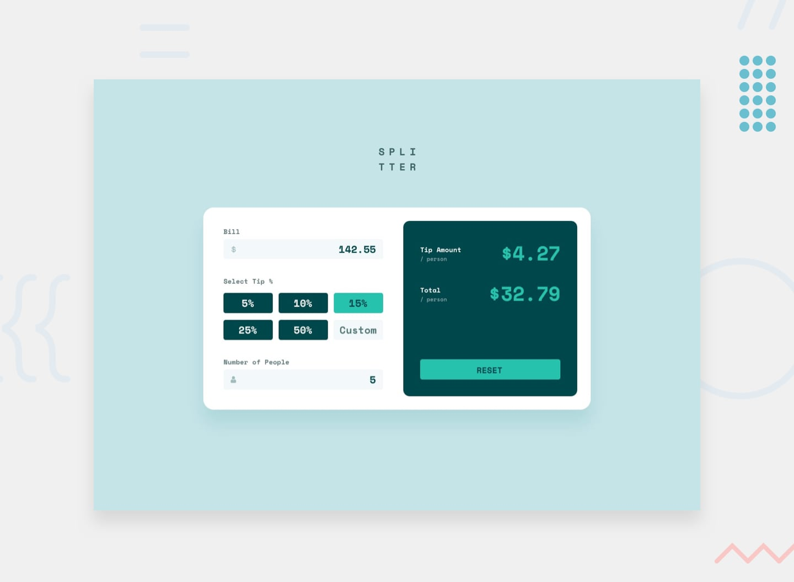

# Frontend Mentor - Tip calculator app solution

This is a solution to the [Tip calculator app challenge on Frontend Mentor](https://www.frontendmentor.io/challenges/tip-calculator-app-ugJNGbJUX). Frontend Mentor challenges help you improve your coding skills by building realistic projects.

## Table of contents

- [Overview](#overview)
  - [The challenge](#the-challenge)
  - [Screenshot](#screenshot)
  - [Links](#links)
- [My process](#my-process)
  - [Built with](#built-with)
  - [What I learned](#what-i-learned)
  - [Continued development](#continued-development)
  - [Useful resources](#useful-resources)
- [Author](#author)
- [Acknowledgments](#acknowledgments)

## Overview

### The challenge

Users should be able to:

- View the optimal layout for the app depending on their device's screen size (Desktop & Mobile)
- See hover and active states for all interactive elements on the page (preset tip buttons, inputs, reset button)
- Calculate the correct tip amount and total cost of the bill per person in real-time
- Enter a custom tip percentage
- View validation error states when number of people is set to 0 ("Can't be zero")
- Reset the calculator to its initial state using the Reset button

### Screenshot



### Links

- Solution URL: [https://github.com/AGreatDev-coder/frontend-mentor/tree/main/tip-calculator-app-main/tip-calculator-app-main](https://github.com/AGreatDev-coder/frontend-mentor/tree/main/tip-calculator-app-main/tip-calculator-app-main)
- Live Site URL: [https://agreatdev-tip-calculator.netlify.app](https://agreatdev-tip-calculator.netlify.app)

## My process

### Built with

- Semantic HTML5 markup (`<header>`, `<main>`, `<output>`, form inputs with matching labels and accessible IDs)
- CSS custom properties (`:root`) for color palette from the style guide
- CSS Grid for the 6-cell tip buttons and custom input layout (`repeat(3, minmax(0, 1fr))` on desktop, `repeat(2, minmax(0, 1fr))` on mobile)
- Flexbox for container alignment, input grouping with SVG icons, and result row formatting
- Mobile-first responsive design using `@media (max-width: 768px)`
- Vanilla JavaScript (ES6+) for real-time calculations, state management, and DOM manipulation
- Google Fonts: [Space Mono](https://fonts.google.com/specimen/Space+Mono) (700 weight)

### What I learned

This challenge was a fantastic milestone combining layout architecture, responsive design, and real-time JavaScript interactivity.

1. **Clean Real-Time State Tracking & Calculation:**
Keeping state variables (`billValue`, `tipPercentage`, `peopleCount`) updated through granular `input` and `click` listeners, followed by a centralized calculation function:

```javascript
function calculateTip() {
    if (peopleCount > 0 && billValue >= 0) {
        const tipTotal = billValue * (tipPercentage / 100);
        const tipPerPerson = tipTotal / peopleCount;
        const totalPerPerson = (billValue + tipTotal) / peopleCount;

        tipAmountDisplay.innerText = `$${tipPerPerson.toFixed(2)}`;
        totalAmountDisplay.innerText = `$${totalPerPerson.toFixed(2)}`;
    }
}
```

2. **Active State Management on Preset Buttons & Custom Tip:**
Seamlessly toggling the `.active` class across preset tip buttons while clearing it when custom input is focused:

```javascript
tipButtons.forEach(btn => {
    btn.addEventListener("click", (e) => {
        document.querySelector(".tip-buttons .active")?.classList.remove("active");
        e.target.classList.add("active");
        tipPercentage = parseInt(e.target.innerText);
        calculateTip(); 
    });
});
```

3. **Hiding Browser Spinners & Styling Focus Rings with `:focus-within`:**
To make the inputs look native and match the design specification:

```css
input::-webkit-outer-spin-button,
input::-webkit-inner-spin-button {
    -webkit-appearance: none;
    margin: 0;
}
input[type=number] {
    -moz-appearance: textfield;
}

.bill-input:focus-within,
.people-input:focus-within,
.tip-buttons input:focus {
    outline: 2px solid var(--clr-primary-cyan);
}
```

4. **Zero Division Error Handling:**
Providing clear visual feedback when users input zero people to avoid infinite division results:

```javascript
peopleInput.addEventListener("input", (e) => {
    peopleCount = parseInt(e.target.value) || 0;
    if (peopleCount === 0) {
        peopleError.style.display = "block";
        peopleInput.parentElement.classList.add("error");
    } else {
        peopleError.style.display = "none";
        peopleInput.parentElement.classList.remove("error");
    }
    calculateTip(); 
});
```

### Continued development

In future projects, I plan to:
- Implement complete keyboard accessibility (aria-live announcements for screen readers when totals update).
- Add smooth number ticker animations when amounts recalculate.

### Useful resources

- [MDN Web Docs - CSS Grid](https://developer.mozilla.org/en-US/docs/Web/CSS/CSS_grid_layout) - Comprehensive guide for building equal-width grid columns using `minmax(0, 1fr)`.
- [MDN Web Docs - Number.prototype.toFixed](https://developer.mozilla.org/en-US/docs/Web/JavaScript/Reference/Global_Objects/Number/toFixed) - Formatting decimal numbers as currency strings.

## Author

- GitHub - [@AGreatDev-coder](https://github.com/AGreatDev-coder)
- Frontend Mentor - [@AGreatDev-coder](https://www.frontendmentor.io/profile/AGreatDev-coder)

## Acknowledgments

Special thanks to the Frontend Mentor community and mentors for guidance on problem-solving patterns, semantic structures, and CSS debugging.
