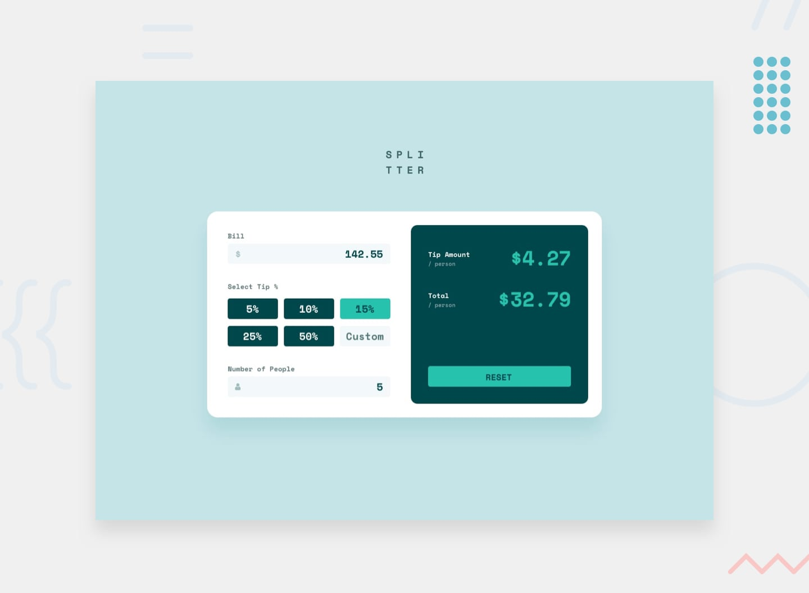

# Splitter - Tip Calculator App 💵

A modern, responsive tip calculator web application that computes tip amounts and bill split totals per person in real time. Designed with an intuitive two-panel layout, interactive percentage selectors, custom tip input, and input validation.



## 🚀 Live Demo

- **Live URL:** [https://agreatdev-tip-calculator.netlify.app](https://agreatdev-tip-calculator.netlify.app)
- **Repository:** [https://github.com/AGreatDev-coder/frontend-mentor/tree/main/tip-calculator-app-main/tip-calculator-app-main](https://github.com/AGreatDev-coder/frontend-mentor/tree/main/tip-calculator-app-main/tip-calculator-app-main)

---

## 📋 Table of Contents

- [Overview](#overview)
- [Key Features](#key-features)
- [Architecture & Technical Details](#architecture--technical-details)
- [Built With](#built-with)
- [Project Structure](#project-structure)
- [Getting Started Locally](#getting-started-locally)
- [Author](#author)

---

## 🔍 Overview

Splitter solves the common problem of dividing restaurant bills and determining fair gratuity quickly. Users enter a bill amount, select a preset tip percentage or type a custom percentage, and input the number of people sharing the bill. The application dynamically outputs both the tip per person and the total amount owed per person.

### User Experience

- **Responsive Design:** Two-column card on desktop screens adapting cleanly to a stacked single-column layout on mobile devices.
- **Instant Real-Time Calculations:** Updates results on every keystroke and button selection.
- **Input Validation:** Clear error cues ("Can't be zero") preventing division-by-zero errors.
- **Quick Reset Flow:** Instantly restore all inputs and outputs to initial default states.

---

## ✨ Key Features

- **Preset & Custom Tip Selection:** 5 preset percentage buttons (5%, 10%, 15%, 25%, 50%) along with an open numeric input for any custom tip percentage.
- **Active State Highlights:** Active preset tip buttons illuminate with strong visual contrast. Selecting a custom percentage clears preset highlights automatically.
- **Zero-Person Error Guard:** Dynamic warning alert when the number of people input is zero or empty, accompanied by red border highlight.
- **Currency Formatted Output:** Tip per person and total per person formatted to two decimal places (`$0.00`).

---

## 📐 Architecture & Technical Details

### 1. Clean Real-Time State Tracking & Calculation
State variables (`billValue`, `tipPercentage`, `peopleCount`) are updated through granular `input` and `click` event listeners, followed by a centralized calculation function:

```javascript
function calculateTip() {
    if (peopleCount > 0 && billValue >= 0) {
        const tipTotal = billValue * (tipPercentage / 100);
        const tipPerPerson = tipTotal / peopleCount;
        const totalPerPerson = (billValue + tipTotal) / peopleCount;

        tipAmountDisplay.innerText = `$${tipPerPerson.toFixed(2)}`;
        totalAmountDisplay.innerText = `$${totalPerPerson.toFixed(2)}`;
    }
}
```

### 2. Active State Management on Preset Buttons & Custom Tip
Seamlessly toggles the `.active` class across preset tip buttons while clearing it whenever a custom input is provided:

```javascript
tipButtons.forEach(btn => {
    btn.addEventListener("click", (e) => {
        document.querySelector(".tip-buttons .active")?.classList.remove("active");
        e.target.classList.add("active");
        tipPercentage = parseInt(e.target.innerText);
        calculateTip(); 
    });
});
```

### 3. Native Number Spinner Removal & Custom Focus Rings
To keep inputs polished and consistent across browsers, standard browser number steppers are removed, and `:focus-within` provides clean custom focus outlines:

```css
input::-webkit-outer-spin-button,
input::-webkit-inner-spin-button {
    -webkit-appearance: none;
    margin: 0;
}
input[type=number] {
    -moz-appearance: textfield;
}

.bill-input:focus-within,
.people-input:focus-within,
.tip-buttons input:focus {
    outline: 2px solid var(--clr-primary-cyan);
}
```

### 4. Zero Division Error Handling
Providing immediate visual feedback when users input zero people to avoid infinite division results:

```javascript
peopleInput.addEventListener("input", (e) => {
    peopleCount = parseInt(e.target.value) || 0;
    if (peopleCount === 0) {
        peopleError.style.display = "block";
        peopleInput.parentElement.classList.add("error");
    } else {
        peopleError.style.display = "none";
        peopleInput.parentElement.classList.remove("error");
    }
    calculateTip(); 
});
```

---

## 🛠️ Built With

- **HTML5:** Semantic markup (`<header>`, `<main>`, `<output>`, form inputs with accessible labels)
- **CSS3:** Custom properties (`:root`), CSS Grid for tip selection layout, Flexbox, media queries
- **Vanilla JavaScript (ES6+):** Event listeners, state management, real-time DOM updates
- **Google Fonts:** [Space Mono](https://fonts.google.com/specimen/Space+Mono) (700 weight)

---

## 📁 Project Structure

```text
tip-calculator-app-main/
└── tip-calculator-app-main/
    ├── images/          # Currency icons, person icon, and logo
    ├── index.html       # Markup structure
    ├── script.js        # Calculator logic & state handling
    ├── style.css        # Responsive layouts & styling
    ├── preview.jpg      # Project preview banner
    └── README.md        # Documentation
```

---

## 💻 Getting Started Locally

1. **Clone the repository:**
   ```bash
   git clone https://github.com/AGreatDev-coder/frontend-mentor.git
   ```

2. **Navigate to the project folder:**
   ```bash
   cd frontend-mentor/tip-calculator-app-main/tip-calculator-app-main
   ```

3. **Open the application:**
   Open `index.html` directly in any web browser.

---

## 👤 Author

- **GitHub:** [@AGreatDev-coder](https://github.com/AGreatDev-coder)
